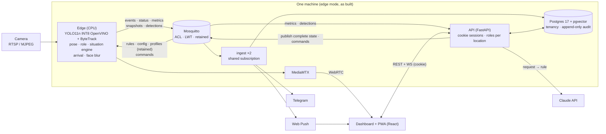

<p align="center">
  
</p>

<p align="center">
  <a href="https://github.com/mariusbuharu-gsd/aivee/actions/workflows/ci.yml"></a>
  <a href="https://github.com/mariusbuharu-gsd/aivee/actions/workflows/pages.yml"></a>
  <a href="LICENSE"></a>
</p>

> **People learn too late what happens in front of their cameras, because nobody has time to watch them.**

AiVee is the staff's extra pair of eyes for restaurants, terraces and events. **No hardware to buy:
plug in the cameras you already have**, draw the tables, write a rule in Romanian, and AiVee alerts the
waiters on their phone when a guest waits too long. It tells staff from guests by uniform and behaviour,
never by face.

- **Cloud (standard).** Cameras stream to one shared AiVee cloud with servers in the EU. Video is
  analysed and discarded, never stored.
- **Edge (option).** The same pipeline runs on the customer's own PC or on our edge box, for maximum
  privacy or offline use: video never leaves the location. It runs on a plain laptop CPU
  ([measured](#measured-performance)).

Decision: [D25](docs/decisions.md), [ADR 0011](docs/adr/0011-cloud-or-edge-analysis.md). In the demo the
laptop plays both roles: it is the "cloud" server, and it shows edge mode on its own CPU.

Built at Astra Hack, Innovation Week Sibiu, 6–7 November 2026.

<!-- TODO(team): replace with docs/media/demo.gif once the demo is recorded. -->
> **Demo GIF:** coming after code freeze. Presentation site: `apps/site` (GitHub Pages).

## Features

| | |
|---|---|
| **Four events** | unattended table · guest raises a hand · queue at the entrance · table not cleared. All four come from one situation engine (present / absent / count / pose / objects + duration). |
| **Rules in Romanian** | "Anunță ospătarul dacă la o masă nu a venit nimeni de 1 minut" → a typed `Rule` draft the owner confirms, edits or discards. Vague or out-of-scope requests get a question back. |
| **Staff by appearance + behaviour** | CLIP embedding of uniform photos plus movement (tables visited, distance per minute). Suggested staff are confirmed with one tap: "Pare angajat — confirmi?". |
| **Privacy by design** | No face recognition, faces blurred in every snapshot. Cloud: video analysed and discarded, never stored, EU servers. Edge: video never leaves the location. See [Privacy](#privacy-by-design). |
| **Alert lifecycle with service times** | opened → acknowledged ("Merg eu" on the phone) → arrived (the edge sees staff in the zone for ≥ 5 s) → closed. Each alert shows wait, reaction and travel time; Metrici shows the median and p90. |
| **Alerts on the phone** | Telegram message with a blurred snapshot, plus a second one when staff arrive. Installable PWA with Web Push: the notification opens the alert. |
| **Live detection overlay** | Live video with a box per person, light blue for staff and white for guests, streamed from the edge at up to 5 Hz. |
| **Accounts and roles per location** | Owner (every location), manager and staff per location, a fixed permission matrix enforced in the API, invites by link, sessions in an HttpOnly cookie. |
| **Multi-location** | Organization → locations (restaurant, terrace, event, shop, other) → devices. Each location has its own team, rules, alerts and Telegram chat. |
| **Audit history** | Append-only log, enforced in Postgres: logins, config changes with before/after, staff decisions, alerts, devices. Shown on Istoric. |

## Architecture



The diagram shows the pipeline as built today, running on one machine (edge mode). In cloud mode the same
pipeline runs in our cloud, fed by the cameras or a small connector on site; that is in progress on
`feature/cloud-mode` (see [ADR 0011](docs/adr/0011-cloud-or-edge-analysis.md)).

More: [docs/architecture.md](docs/architecture.md) (context and containers, tenancy, auth and permissions,
audit, alert lifecycle and request → rule sequences, MQTT topics, scalability) and the [ADRs](docs/adr/):

1. [Edge-first CPU inference with OpenVINO](docs/adr/0001-edge-first-cpu-inference.md)
2. [MQTT with ACL, LWT, retained state, shared subscriptions](docs/adr/0002-mqtt-acl-lwt-retained-shared.md)
3. [Postgres 17 + pgvector](docs/adr/0003-postgres-pgvector.md)
4. [Contracts as the single source of truth](docs/adr/0004-contracts-single-source-of-truth.md)
5. [Staff by appearance + behaviour, no face recognition](docs/adr/0005-staff-by-appearance-and-behaviour.md)
6. [LLM turns the request into a rule, human confirms](docs/adr/0006-llm-request-to-rule.md)
7. [Opaque sessions in an HttpOnly cookie, not JWT](docs/adr/0007-session-cookie-not-jwt.md)
8. [Roles per location with a fixed permission matrix](docs/adr/0008-roles-per-location-fixed-matrix.md)
9. [Append-only audit log, enforced in the database](docs/adr/0009-append-only-audit-log-in-db.md)
10. ["Arrived" detected on the edge, not self-reported](docs/adr/0010-arrival-detected-on-edge.md)
11. [Cloud or edge analysis, per customer](docs/adr/0011-cloud-or-edge-analysis.md) (partly supersedes ADR 1)

## Tech stack

| Layer | Tech |
|---|---|
| Edge | Python 3.12, Ultralytics YOLO11n + pose, OpenVINO INT8 (NNCF), ByteTrack, OpenCLIP, OpenCV, paho-mqtt |
| Messaging | Eclipse Mosquitto 2 (per-device ACL, LWT, retained, QoS 1, shared subscriptions) |
| Backend | FastAPI, SQLAlchemy 2 (async) + asyncpg, Alembic, aiomqtt, Anthropic SDK (structured outputs), argon2-cffi, pywebpush (VAPID) |
| Data | Postgres 17 + pgvector |
| Video | MediaMTX (RTSP in, WebRTC/WHEP out) |
| Frontend | Vite 8, React 19, React Router, TypeScript strict, plain CSS on design tokens, vite-plugin-pwa + Workbox; static site in plain HTML/CSS |
| Contracts | Pydantic → JSON Schema → TypeScript types |
| Tooling | uv workspace, ruff, mypy (strict on contracts and edge domain), pytest + testcontainers, Vitest, ESLint, GitHub Actions, gitleaks |

## Quickstart

Needs Docker, [uv](https://docs.astral.sh/uv/) and Node 24.

```bash
cp .env.example .env     # fill in the names listed there (or: make keys; make vapid for push)
make dev                 # install the Python workspace
make data-dirs           # data/snapshots and recordings, owned by you
make up                  # Mosquitto, Postgres+pgvector, migrations, MediaMTX, ingest ×2, API :8000
make seed                # demo org, location `demo`, owner@ / manager@ / staff@aivee.demo
                         # (password DEMO_PASSWORD in .env)
make fake-edge SCENARIO=unattended SPEED=10   # scripted scenario through the real pipeline
                                              # (unattended | hand | queue | uncleared)
cd apps/dashboard && npm ci
VITE_API_URL=http://localhost:8000 npm run dev   # dashboard; omit VITE_API_URL for the offline mock
```

Open `http://localhost:5173/intra` and log in as `owner@aivee.demo`.

With a real camera: `uv run python tools/download_models.py`, then
`make edge SOURCE=http://<phone>:8080/video ROTATE=90` (Android IP Webcam stream). Backup clip:
`make record SOURCE=http://<phone>:8080/video SECONDS=60 ROTATE=90 NAME=sala-1`, replay with
`make edge SOURCE=recordings/sala-1.mp4`. The 4-minute demo: [docs/demo-script.md](docs/demo-script.md).
All commands: [backend handbook](docs/handbook/backend.md) · [frontend handbook](docs/handbook/frontend.md).

## Repository map

```
apps/
  edge/        camera → detection, tracking, pose, role, situation engine, arrival, blur → MQTT
               domain/ is pure (no IO) behind Protocol ports; adapters/ for YOLO, CLIP, MQTT, blur
  ingest/      shared-subscription worker → Postgres (alert times, audit) → Telegram + Web Push
  api/         FastAPI: REST + WS, accounts, roles per location, invites, audit, alert lifecycle,
               retained edge state, request → rule, staff enrolment, push, Alembic
  dashboard/   React 19 dashboard + PWA (Romanian UI)
  site/        static presentation site (GitHub Pages)
packages/
  contracts/   Pydantic models + MQTT topic builder → JSON Schema → TS types
infra/         mosquitto, postgres, mediamtx config
evals/         nl_to_rule: 20 Romanian requests → expected rules
tools/         fake_edge.py, record_clip.py, bench_edge.py, download_models.py, gen_vapid.py, setup scripts
docs/          architecture, ADRs, decisions log, handbooks, plans, demo script, brand
```

## How we test

| Suite | Command | Result (2026-11-06) |
|---|---|---|
| Python unit | `uv sync --all-packages -q && uv run pytest -q` | 362 passed |
| Python integration (testcontainers: Mosquitto, Postgres + pgvector) | `uv run pytest -q -m integration` | 105 passed, 2 skipped ¹ |
| Dashboard (Vitest) | `cd apps/dashboard && npm ci && npx vitest run` | 100 passed (13 files) |
| Request → rule eval (real API calls) | `make eval` | 20/20, median 2.4 s, max 4.0 s |

¹ One test, `test_fake_edge_alert_is_acknowledged_arrives_and_closes`, is timing-sensitive: on 2026-11-06 it
failed in 2 of 3 full runs and passed alone and in the third run.

Unit tests cover the situation engine on simulated timelines (cooldown, arrival after `ARRIVE_S`, close),
behaviour and role scoring, zone geometry, the permission matrix cell by cell, sessions and the login rate
limit, alert lifecycle times and percentiles, and push. Integration tests cover MQTT → Postgres (duplicates
ignored), LWT → offline, retained state on reconnect, pgvector lookups, login and invites, scoping between
locations and organizations, the audit log rejecting UPDATE / DELETE, and the fake edge → ack → arrived →
closed lifecycle. CI runs lint, mypy, all Python tests with coverage,
contract drift checks (JSON Schema and TS types), the dashboard lint/tests/build, the site build and a
gitleaks scan of the full history.

## Privacy by design

Two modes, two honest claims:

| Cloud (standard) | Edge (option) |
|---|---|
| Video is analysed and discarded, never stored. | Video never leaves the location. |
| Servers in the EU. | Analysis runs on the customer's PC or our edge box. |
| What is kept: alerts, metrics, audit history and blurred snapshots. | What leaves: alerts, metrics and blurred snapshots, over MQTT. |

In both modes:

- **Faces blurred in every snapshot**, before it is stored or sent (Telegram, push, dashboard).
- **Role, not identity.** AiVee decides only "guest" or "staff", from uniform and movement. No face
  recognition (GDPR art. 9 biometrics, EU AI Act); requests to recognise a person are refused.
- **The rule request sends text only** to the Claude API, never images.
- **Least access.** Staff see only their location's alerts; the history records who did what and cannot be edited.
- **Human in the loop.** Rules are drafts until the owner confirms them; suggested staff are confirmed
  or rejected explicitly.

## Measured performance

Measured per camera stream, on a laptop CPU with no GPU: the pipeline is cheap to run, which is what makes
edge mode on an ordinary PC possible. Cloud cost per stream is not measured yet, so we quote none.

| What | Number | Setup |
|---|---|---|
| Detection | ~20 FPS | YOLO11n INT8 OpenVINO, i7-1355U CPU, no GPU |
| Detection + pose | ~12 FPS | pose only inside table zones |
| Phone camera stream | 8–11 FPS | Android IP Webcam, 640×480 MJPEG (the camera is the bottleneck) |
| Romanian request → rule | 20/20, median 2.4 s | `evals/nl_to_rule`, see [results](evals/nl_to_rule/results.md) |

## Design system

Logo, colours, type and voice: [docs/brand/README.md](docs/brand/README.md) (tokens in
[docs/brand/tokens.css](docs/brand/tokens.css)).

## Team

Marius Buharu · Vasi Dancu · Radu Nedela

<!-- TODO(team): add roles. -->

## Licensing

- **Our code is MIT** ([LICENSE](LICENSE)), and stays open (decision [D26](docs/decisions.md)).
- **The detector is not.** The edge depends on [Ultralytics YOLO](https://github.com/ultralytics/ultralytics)
  (`ultralytics` 8.4.203 in `uv.lock`), licensed **AGPL-3.0**.
- **What that means.** AGPL-3.0 also covers software used over a network. When we run the pipeline in our
  cloud, or distribute it on an edge box or a customer's PC, the complete source of what runs, including our
  changes, must be available to its users under AGPL-3.0. The alternative is an Ultralytics Enterprise
  licence. Anyone who redistributes AiVee with Ultralytics inherits the same obligation; AiVee's own files
  remain usable under MIT.
