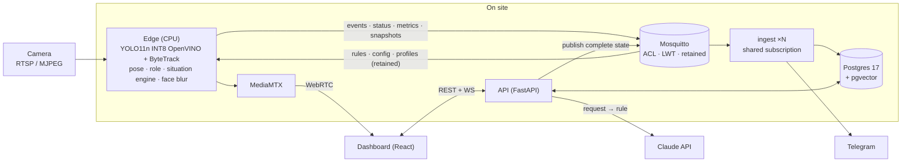

<p align="center">
  
</p>

<p align="center">
  <a href="https://github.com/mariusbuharu-gsd/aivee/actions/workflows/ci.yml"></a>
  <a href="https://github.com/mariusbuharu-gsd/aivee/actions/workflows/pages.yml"></a>
  <a href="LICENSE"></a>
</p>

> **People learn too late what happens in front of their cameras, because nobody has time to watch them.**

AiVee is the staff's extra pair of eyes for restaurants, terraces and events. Point an existing
camera at the room, draw the tables, write a rule in Romanian, and AiVee alerts the waiters on
their phone when a guest waits too long. It tells staff from guests by uniform and behaviour,
never by face, and runs on a CPU on site.

Built at Astra Hack, Innovation Week Sibiu, 6–7 November 2026.

<!-- TODO(team): replace with docs/media/demo.gif once the demo is recorded. -->
> **Demo GIF:** coming after code freeze. Presentation site: `apps/site` (GitHub Pages).

## Features

| | |
|---|---|
| **Four events** | unattended table · guest raises a hand · queue at the entrance · table not cleared. All four come from one situation engine (present / absent / count / pose / objects + duration). |
| **Rules in Romanian** | "Anunță ospătarul dacă la o masă nu a venit nimeni de 1 minut" → a typed `Rule` draft the owner confirms, edits or discards. Vague or out-of-scope requests get a question back. |
| **Staff by appearance + behaviour** | CLIP embedding of uniform photos plus movement (tables visited, distance per minute). Suggested staff are confirmed with one tap: "Pare angajat — confirmi?". |
| **Privacy by design** | No face recognition, faces blurred on the device, video never leaves the site. |
| **Alerts** | Telegram message with a blurred snapshot; the alert closes itself when staff reach the table. Live dashboard with zones, rules, alerts, devices and metrics. |

## Architecture



More: [docs/architecture.md](docs/architecture.md) (C4 context and containers, alert and request → rule
sequences, MQTT topics, scalability) and the [ADRs](docs/adr/):

1. [Edge-first CPU inference with OpenVINO](docs/adr/0001-edge-first-cpu-inference.md)
2. [MQTT with ACL, LWT, retained state, shared subscriptions](docs/adr/0002-mqtt-acl-lwt-retained-shared.md)
3. [Postgres 17 + pgvector](docs/adr/0003-postgres-pgvector.md)
4. [Contracts as the single source of truth](docs/adr/0004-contracts-single-source-of-truth.md)
5. [Staff by appearance + behaviour, no face recognition](docs/adr/0005-staff-by-appearance-and-behaviour.md)
6. [LLM turns the request into a rule, human confirms](docs/adr/0006-llm-request-to-rule.md)

## Tech stack

| Layer | Tech |
|---|---|
| Edge | Python 3.12, Ultralytics YOLO11n + pose, OpenVINO INT8 (NNCF), ByteTrack, OpenCLIP, OpenCV, paho-mqtt |
| Messaging | Eclipse Mosquitto 2 (per-device ACL, LWT, retained, QoS 1, shared subscriptions) |
| Backend | FastAPI, SQLAlchemy 2 (async) + asyncpg, Alembic, aiomqtt, Anthropic SDK (structured outputs) |
| Data | Postgres 17 + pgvector |
| Video | MediaMTX (RTSP in, WebRTC/WHEP out) |
| Frontend | Vite 8, React 19, TypeScript strict, plain CSS on design tokens; static site in plain HTML/CSS |
| Contracts | Pydantic → JSON Schema → TypeScript types |
| Tooling | uv workspace, ruff, mypy (strict on contracts and edge domain), pytest + testcontainers, Vitest, ESLint, GitHub Actions, gitleaks |

## Quickstart

Needs Docker, [uv](https://docs.astral.sh/uv/) and Node 24.

```bash
cp .env.example .env     # fill in the names listed there (or: make keys)
make dev                 # install the Python workspace
make up                  # Mosquitto, Postgres+pgvector, MediaMTX, ingest ×2, API :8000
make fake-edge SCENARIO=unattended SPEED=10   # scripted scenario through the real pipeline
                                              # (unattended | hand | queue | uncleared)
cd apps/dashboard && npm ci
VITE_API_URL=http://localhost:8000 npm run dev   # dashboard; omit VITE_API_URL for the offline mock
```

With a real camera: `uv run python tools/download_models.py`, then
`make edge SOURCE=http://<phone>:8080/video` (Android IP Webcam stream).
All commands: [backend handbook](docs/handbook/backend.md) · [frontend handbook](docs/handbook/frontend.md).

## Repository map

```
apps/
  edge/        camera → detection, tracking, pose, role, situation engine, blur → MQTT
               domain/ is pure (no IO) behind Protocol ports; adapters/ for YOLO, CLIP, MQTT, blur
  ingest/      shared-subscription worker → Postgres → Telegram
  api/         FastAPI: REST + WS, retained edge state, request → rule, staff enrolment, Alembic
  dashboard/   React 19 dashboard (Romanian UI)
  site/        static presentation site (GitHub Pages)
packages/
  contracts/   Pydantic models + MQTT topic builder → JSON Schema → TS types
infra/         mosquitto, postgres, mediamtx config
evals/         nl_to_rule: 20 Romanian requests → expected rules
tools/         fake_edge.py, bench_edge.py, download_models.py, setup scripts
docs/          architecture, ADRs, decisions log, handbooks, plans, brand
```

## How we test

| Suite | Command | Result (2026-11-06) |
|---|---|---|
| Python unit | `uv run pytest -q` | 213 passed |
| Python integration (testcontainers: Mosquitto, Postgres + pgvector) | `uv run pytest -q -m integration` | 37 passed, 2 skipped |
| Dashboard (Vitest) | `cd apps/dashboard && npm ci && npm test -- --run` | 42 passed (6 files) |
| Request → rule eval (real API calls) | `make eval` | 20/20, median 2.4 s, max 4.0 s |

Unit tests cover the situation engine on simulated timelines, cooldown and alert close, behaviour and role
scoring, and zone geometry. Integration tests cover MQTT → Postgres (duplicates ignored), LWT → offline,
retained state on reconnect and pgvector lookups. CI runs lint, mypy, all Python tests with coverage,
contract drift checks (JSON Schema and TS types), the dashboard lint/tests/build, the site build and a
gitleaks scan of the full history.

## Privacy by design

- **Role, not identity.** AiVee decides only "guest" or "staff", from uniform and movement. No face
  recognition (GDPR art. 9 biometrics, EU AI Act); requests to recognise a person are refused.
- **Faces blurred on the device** before a snapshot leaves the edge.
- **Video stays on site.** Only alerts, metrics and blurred snapshots travel over MQTT; the rule request
  sends text only.
- **Human in the loop.** Rules are drafts until the owner confirms them; suggested staff are confirmed
  or rejected explicitly.

## Measured performance

| What | Number | Setup |
|---|---|---|
| Detection | ~20 FPS | YOLO11n INT8 OpenVINO, i7-1355U CPU, no GPU |
| Detection + pose | ~12 FPS | pose only inside table zones |
| Phone camera stream | 8–11 FPS | Android IP Webcam, 640×480 MJPEG (the camera is the bottleneck) |
| Romanian request → rule | 20/20, median 2.4 s | `evals/nl_to_rule`, see [results](evals/nl_to_rule/results.md) |

## Design system

Logo, colours, type and voice: [docs/brand/README.md](docs/brand/README.md) (tokens in
[docs/brand/tokens.css](docs/brand/tokens.css)).

## Team

Marius Buharu · Vasi Dancu · Radu Nedela

<!-- TODO(team): add roles. -->

## License

[MIT](LICENSE)
