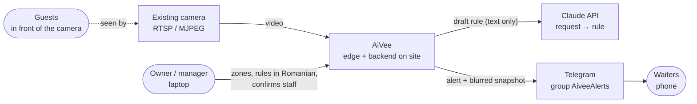
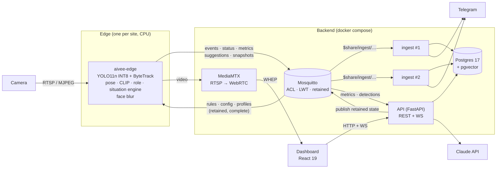
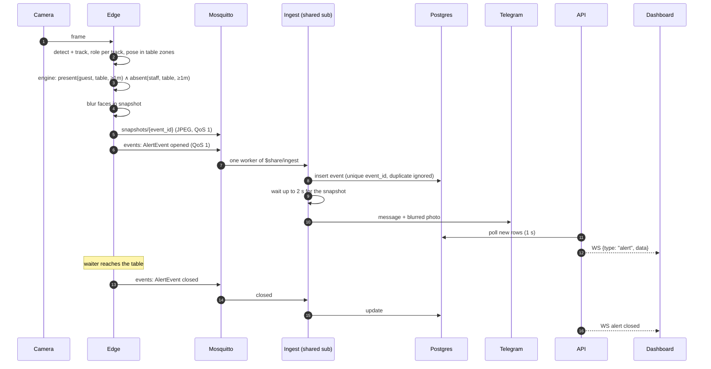
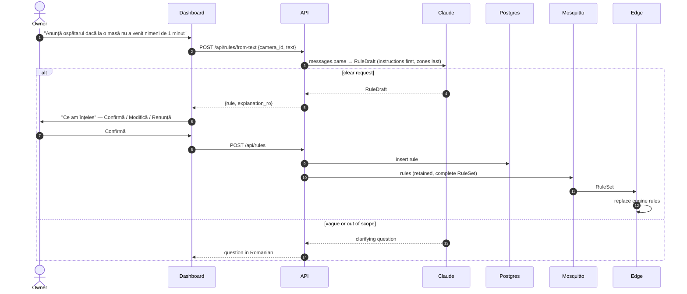

# AiVee architecture

What runs where, how an alert travels, and how the system grows. Decisions and trade-offs
are in the [ADRs](adr/); the topic contract is owned by the [backend handbook](handbook/backend.md).

## 1. Context

Only text leaves the site: the rule request to Claude and the alert (with a blurred snapshot)
to Telegram. Video never does.

## 2. Containers

| Container | Code | Responsibility |
|---|---|---|
| edge | `apps/edge` | camera → detect, track, pose, role → situation engine → blurred snapshot → MQTT. Pure `domain/` behind `Protocol` ports; adapters for YOLO, CLIP, MQTT, blur |
| ingest ×2 | `apps/ingest` | shared subscription → Postgres (duplicates ignored) → Telegram |
| api | `apps/api` | REST + WS for the dashboard; publishes retained edge state; request → rule; staff enrolment |
| mosquitto | `infra/mosquitto` | broker, auth and per-device ACL |
| postgres | `infra/postgres` | source of truth; Alembic migrations |
| mediamtx | `infra/mediamtx` | live video for the dashboard |
| dashboard | `apps/dashboard` | zones, rules, alerts, devices, metrics, staff confirmation |
| contracts | `packages/contracts` | Pydantic models + topic builder → JSON Schema → TS types ([ADR 4](adr/0004-contracts-single-source-of-truth.md)) |

## 3. An alert, end to end

## 4. A Romanian request becomes a rule

Eval: 20 Romanian requests → 20/20 correct, median 2.4 s ([ADR 6](adr/0006-llm-request-to-rule.md)).

## 5. MQTT topics

Always built through `aivee_contracts.topics.Topics`. Root `aivee/<site>/<device>/…`

| Leaf | Direction | QoS / retain | Payload |
|---|---|---|---|
| `status` | edge → | 1, retained, LWT `offline` | DeviceStatus |
| `events` | edge → | 1 | AlertEvent (opened/closed) |
| `metrics` | edge → | 0 | Metrics (every 5 s) |
| `suggestions` | edge → | 1 | StaffSuggestion |
| `snapshots/<id>` | edge → | 1 | blurred JPEG bytes |
| `rules` | → edge | 1, retained | RuleSet (complete) |
| `config` | → edge | 1, retained | DeviceConfig: cameras + zones (complete) |
| `profiles` | → edge | 1, retained | StaffProfiles (complete) |
| `commands`, `detections` | → edge / edge → | 1 / 0 | staff confirm/reject commands / live boxes |

Ingest uses `$share/ingest/aivee/+/+/events` and `.../suggestions`. ACL: each edge user writes only its own
device topics (`%u`), so `DEVICE` must equal `MQTT_EDGE_USER` (`edge-01`).

## 6. Scalability

| Lever | How it scales |
|---|---|
| **One edge per site** | Video is processed where it is filmed. Adding a restaurant adds a box, not load on a central GPU. Bandwidth per site is alerts, metrics and small JPEGs. |
| **Shared subscriptions** | `$share/ingest/…` lets the broker spread events across ingest workers. More traffic → start more workers; no partitioning code. |
| **Horizontal, idempotent ingest** | QoS 1 is at-least-once; `event_id` and `suggestion_id` are unique in Postgres, so a redelivered message is ignored. Workers are stateless. |
| **Retained, complete state** | Rules, config and staff profiles are published whole and retained. A new or rebooted edge is in sync on connect; the API never tracks per-edge diffs. |
| **Per-device ACL** | Each edge has its own MQTT user and may write only `aivee/<site>/<its id>/…`. A compromised edge cannot spoof another; onboarding is a user + ACL entry. |
| **Topic hierarchy** | `aivee/<site>/<device>/<leaf>` lets consumers subscribe per site or across all sites with wildcards. |
| **Contracts** | One Pydantic definition for every service; CI fails on drift, so new services and fields stay compatible. |

Current limits (MVP): one broker and one Postgres per deployment; the WebSocket feed polls Postgres every
second; no multi-tenant auth.
