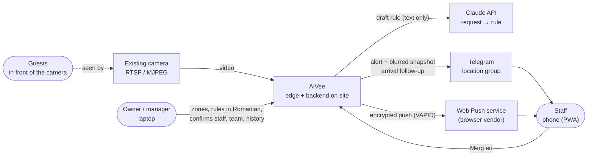
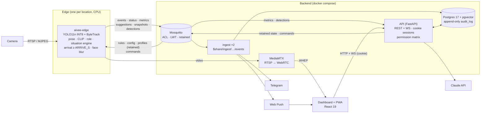
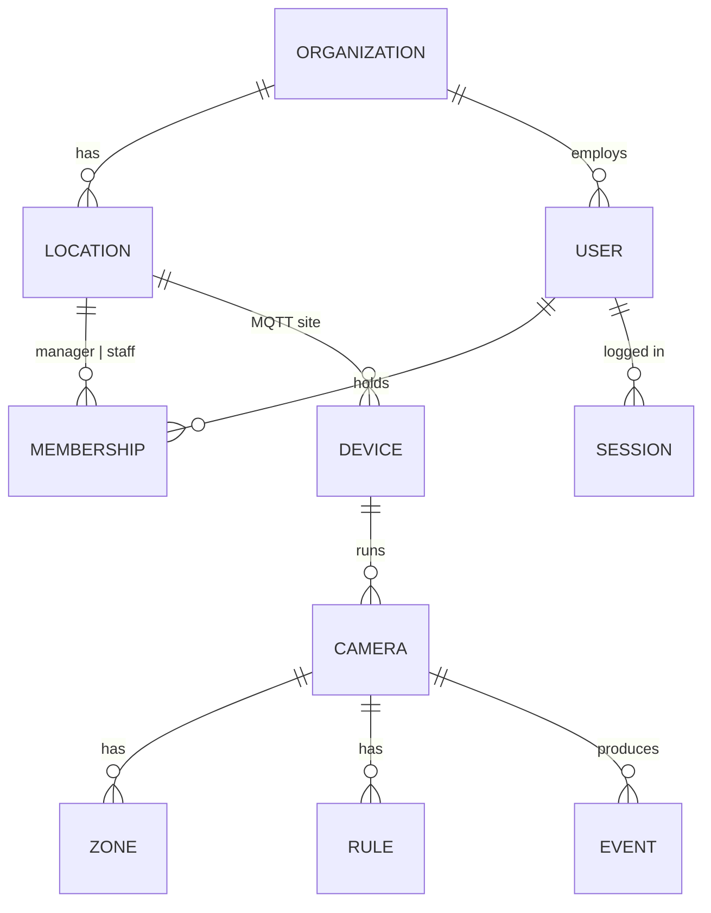
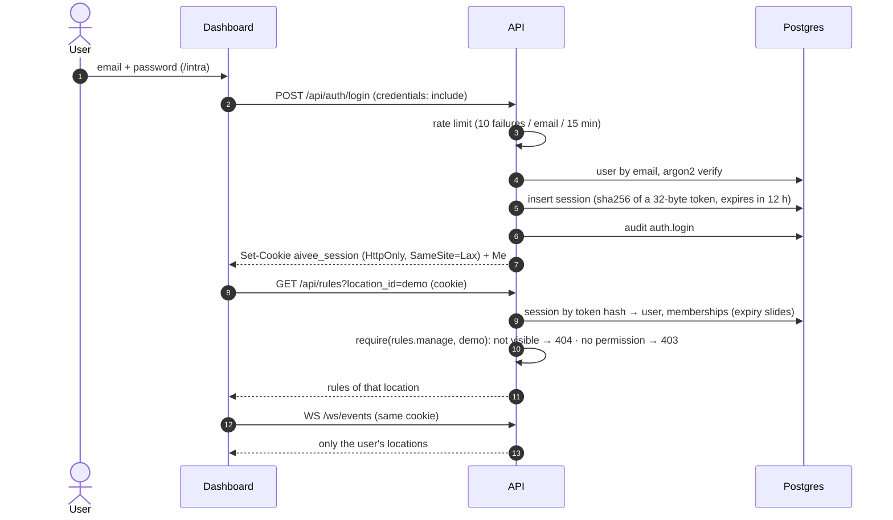
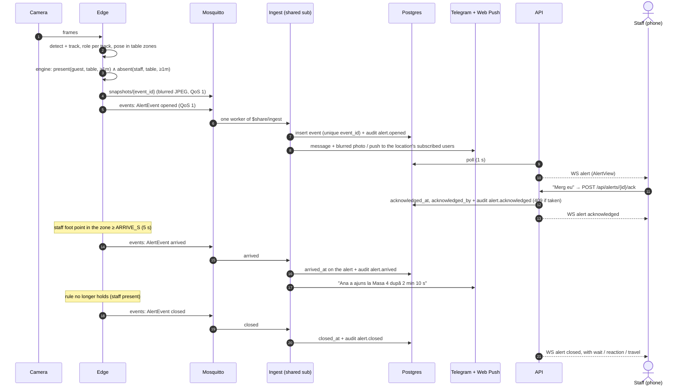
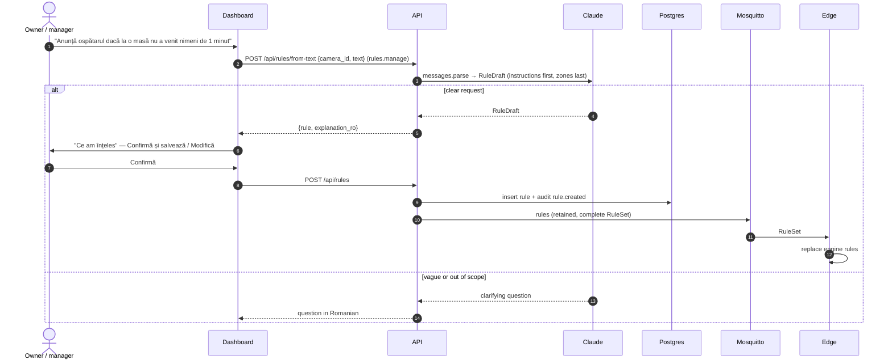

# AiVee architecture

What runs where, who may see what, how an alert travels, and how the system grows. Decisions and
trade-offs are in the [ADRs](adr/); the topic contract is owned by the [backend handbook](handbook/backend.md).

## 1. Context

Only text and blurred snapshots leave the site: the rule request to Claude, the alert to Telegram
and an encrypted push message. Video never does.

## 2. Containers

| Container | Code | Responsibility |
|---|---|---|
| edge | `apps/edge` | camera → detect, track, pose, role → situation engine (opened / arrived / closed) → blurred snapshot → MQTT; live boxes on `detections`. Pure `domain/` behind `Protocol` ports |
| ingest ×2 | `apps/ingest` | MQTT → Postgres (duplicates ignored), alert times folded, audit `alert.*` / `device.*` → Telegram (per-location chat) + Web Push |
| api | `apps/api` | REST + WS; accounts, sessions, roles, invites, audit; publishes retained edge state and staff commands; request → rule; staff enrolment |
| mosquitto | `infra/mosquitto` | broker, auth and per-device ACL |
| postgres | `infra/postgres` | source of truth; Alembic migrations (`migrate` service) |
| mediamtx | `infra/mediamtx` | live video for the dashboard |
| dashboard | `apps/dashboard` | live with detection overlay, zones, rules, alerts with "Merg eu", metrics, history, team, locations; installable PWA with push |
| contracts | `packages/contracts` | Pydantic models + topic builder → JSON Schema → TS types ([ADR 4](adr/0004-contracts-single-source-of-truth.md)) |

## 3. Tenancy

- **Organization → location → devices.** A location is a `sites` row (type `restaurant`, `terrace`,
  `event`, `shop` or `other`) and its id is the MQTT `<site>` segment. It may have its own
  `telegram_chat_id`; otherwise ingest uses `TELEGRAM_CHAT_ID`.
- **Users and memberships.** A user belongs to one organization. `is_owner` → role `owner` at every location
  of the org; otherwise a membership gives `manager` or `staff` at one location. New people join through an
  invite link (7 days, single use).
- Cameras, zones, rules, events and suggestions are scoped through their device or camera. Asking for a
  resource of a location you cannot see returns 404 ([ADR 8](adr/0008-roles-per-location-fixed-matrix.md)).

## 4. Auth and permissions

- **Session** ([ADR 7](adr/0007-session-cookie-not-jwt.md)): opaque token in an HttpOnly cookie, only its hash
  stored; logout deletes the row. `COOKIE_SECURE=true` behind HTTPS.
- **Permission check** ([ADR 8](adr/0008-roles-per-location-fixed-matrix.md)): one fixed matrix in
  `auth/permissions.py`; `require(permission)` resolves `?location_id=` (default: the user's first location)
  to the caller's role there. Routes that take a resource id (camera, rule, suggestion, alert) find its
  location first. The dashboard's `can()` only hides UI.
- **WebSocket**: the handshake cookie decides which locations' alerts, suggestions and detections the socket
  receives; without a valid session it is closed with 1008.

## 5. Audit history

[ADR 9](adr/0009-append-only-audit-log-in-db.md). `audit_log` is append-only in Postgres: `UPDATE`, `DELETE`
and `TRUNCATE` are revoked, and triggers reject them for owners and superusers too.

| Writer | Kinds |
|---|---|
| API (actor = user) | `auth.login`, `auth.login_failed`, `auth.logout`, `user.invited`, `user.joined`, `member.role_changed`, `member.removed`, `location.created|updated|deleted`, `camera.created`, `camera.updated`, `zones.updated`, `rule.created|updated|deleted`, `staff.confirmed`, `staff.rejected`, `staff.enrolled`, `alert.acknowledged` |
| Ingest (actor = device) | `alert.opened`, `alert.arrived`, `alert.closed` (same transaction as the event row), `device.online`, `device.offline` |

Configuration changes carry `before` / `after` JSON; every entry has a Romanian `summary_ro`.
`GET /api/audit`: owner → whole organization, manager → own location, staff → own actions.
The dashboard shows it on **Istoric** (`/istoric`).

## 6. An alert, end to end: opened → acknowledged → arrived → closed

[ADR 10](adr/0010-arrival-detected-on-edge.md): arrival comes from the camera, not from a button.
Times: wait = arrived (or closed) − opened, reaction = acknowledged − opened, travel = arrived − acknowledged.
`GET /api/metrics/service` returns the median and p90 of each; the **Metrici** page shows them.
`arrived` without an acknowledgement is shown as "fără preluare".

## 7. A Romanian request becomes a rule

Eval: 20 Romanian requests → 20/20 correct, median 2.4 s ([ADR 6](adr/0006-llm-request-to-rule.md)).

## 8. MQTT topics

Always built through `aivee_contracts.topics.Topics`. Root `aivee/<site>/<device>/…` (`<site>` = location id).

| Leaf | Direction | QoS / retain | Payload |
|---|---|---|---|
| `status` | edge → | 1, retained, LWT `offline` | DeviceStatus |
| `events` | edge → | 1 | AlertEvent (`opened` / `arrived` / `closed`) |
| `metrics` | edge → | 0 | Metrics (every 5 s) |
| `suggestions` | edge → | 1 | StaffSuggestion |
| `snapshots/<id>` | edge → | 1 | blurred JPEG bytes (event or suggestion id) |
| `detections` | edge → | 0, ≤ 5 Hz | Detections: tracks (box, role, staff_score, raised_hand) for the live overlay |
| `rules` | → edge | 1, retained | RuleSet (complete) |
| `config` | → edge | 1, retained | DeviceConfig: cameras + zones (complete) |
| `profiles` | → edge | 1, retained | StaffProfiles (complete) |
| `commands` | → edge | 1 | EdgeCommand `confirm_staff` / `reject_staff` |
| `frames/<camera>` | api → vision worker | 0 | JPEG frames a connector posted over HTTPS (cloud mode behind port 443) |

Ingest splits `events` across replicas with `$share/ingest/aivee/+/+/events`; every replica also reads
`status`, `suggestions`, `snapshots/+` and `metrics` (inserts are idempotent; each replica stores the
snapshot file). The API reads `metrics` and `detections`. ACL: each edge user writes only its own device
topics (`%u`), so `DEVICE` must equal `MQTT_EDGE_USER` (`edge-01`).

## 9. Scalability

| Lever | How it scales |
|---|---|
| **One edge per location** | Video is processed where it is filmed. Adding a location adds a box, not load on a central GPU. Bandwidth per location is alerts, metrics, boxes and small JPEGs. |
| **Shared subscriptions** | `$share/ingest/…/events` lets the broker spread alerts across ingest workers. More traffic → start more workers; no partitioning code. |
| **Horizontal, idempotent ingest** | QoS 1 is at-least-once; `event_id` and `suggestion_id` are unique in Postgres, so a redelivered message is ignored. Device status changes are serialised with an advisory lock so they are audited once. |
| **Retained, complete state** | Rules, config and staff profiles are published whole and retained. A new or rebooted edge is in sync on connect; the API never tracks per-edge diffs. |
| **Per-device ACL** | Each edge has its own MQTT user and may write only `aivee/<site>/<its id>/…`. A compromised edge cannot spoof another; onboarding is a user + ACL entry. |
| **Tenancy in the data** | Organization → location → device is in every query; adding a location or an organization is rows, not a deployment. |
| **Contracts** | One Pydantic definition for every service; CI fails on drift, so new services and fields stay compatible. |

Current limits (MVP): one broker, one Postgres and one API process per deployment; the WebSocket feed
polls Postgres every second; the login rate limit is in memory; the API's MQTT link serves one location
(`SITE` / `DEVICE`), so cameras can be added only there; staff photo profiles are shared by all locations.
